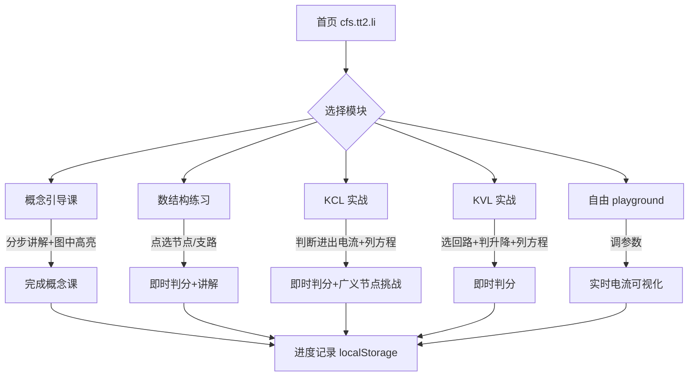

# PRD：CFS Lab — 电路基础与系统 · 引导式交互学习站

- 版本：v0.1（待确认）
- 日期：2026-10-09
- 目标用户：杭州电子科技大学《电路基础与系统》课程学生（英语专业跨修，电路基础薄弱，需要「看得懂、点得着、判得对」的引导式练习）
- 线上地址：https://cfs.tt2.li

## 1. 背景与目标

课堂 PPT（2.1 基尔霍夫定律）进度快、概念抽象（支路/节点/回路/网孔/KCL/KVL），学生课下缺少「能动手试」的练习工具。做一个纯静态交互小站：把课堂例题变成可以点、可以选、即时判分的互动实验，跟着引导一步步上手。

## 2. 范围

### MVP（本次交付）

课程内容覆盖 **第 2.1 节 基尔霍夫定律**，功能模块：

1. **概念引导课（Guided Tour）**
   - scrollytelling 分步讲解：参考方向 → 支路/节点/回路/网孔 → KCL → KVL
   - 每一步配可交互的电路图小部件，滚动到某步时图中高亮对应元素
2. **数结构练习**
   - 给出与课堂例题同构的电路图（SVG 绘制，元件 1-7、节点 ①-⑤）
   - 用户点击图中节点/支路进行选择作答，统计「图中有几条支路/几个节点/几个网孔」
   - 即时判分 + 讲解：为什么 3 和 4 算串联时可以合并成 6 条支路
3. **KCL 实战（例 1 互动版）**
   - 复刻课堂例 1 电路（i₁…i₅ 参考方向已标好）
   - 用户依次点选每个节点「哪些电流流入、哪些流出」，然后列方程
   - 支持广义节点练习（红色虚线闭合面）
   - 即时判分、错误提示（哪个节点的进出判断错了）、独立方程个数的讲解
4. **KVL 实战**
   - 标注电压参考极性（+/-）的电路图
   - 用户选一个回路、定绕行方向、逐项判断电压升/降，列 Σu=0
   - 即时判分 + 网孔 vs 回路辨析
5. **自由 playground**
   - 简单两网孔电路：可调电压源、电阻滑杆
   - 前端实时求解（欧姆定律 + KCL/KVL 线性求解），电流箭头随数值变化、方向变反时高亮提示「参考方向 vs 实际方向」
6. **学习进度**
   - localStorage 记录各模块完成状态，首页显示进度条

### 非目标（本期不做）

- 账号系统 / 后端 / 数据库
- 完整 SPICE 级仿真（不做非线性元件、不做暂态）
- 课程其他章节内容（架构上预留扩展）

## 3. 用户流程

## 4. 技术方案

- 构建：Vite 8.3.4（2026-10 最新稳定版，已取代任务书里的 Vite 7；Node ^20.19 起，本机 v20.20.2 满足）+ @vitejs/plugin-react 6.1.2
- 框架：React 19.3.0 + TypeScript 7.0.2（strict，moduleResolution: bundler）
- 样式：Tailwind CSS 4.3.3（@tailwindcss/vite 4.3.3 插件新范式，无 tailwind.config.js）
- 图标：lucide-react 1.53.0（本地包，无 CDN）
- 动效：motion 14.0.0（原 framer-motion 新名），步骤切换与电流流动动画
- 状态：Zustand 5.0.15（进度持久化 store），其余用 React 19 内置 hooks
- 测试：Vitest 4.1.11（vitest 5 要求 Node ^22.12，本机 20.20.2 不满足，取支持 Node 20 的最新 4.x）+ jsdom 30.1.2 + Testing Library 16.3.3
- Lint：ESLint 10.12.0 + typescript-eslint 8.71.1 + eslint-plugin-react-hooks 7.1.1 + eslint-plugin-react-refresh 0.5.7
- 电路图：自研 SVG 渲染层（元件/节点/支路为数据驱动，可点击、高亮、动画电流）
- 电路求解器：自研极简线性求解（高斯消元，支持 KCL/KVL playground 场景）
- 构建产物：纯静态，输出 dist/
- 部署：构建产物经 SFTP 上传至 VPS `/srv/sites/cfs.tt2.li/`，新增 `/etc/caddy/sites.d/cfs.tt2.li.caddy`（复用现有模板：root + encode + 安全头 + 静态资源长缓存 + file_server），Caddy 自动签发 SSL，`systemctl reload caddy`
- 仓库：GitHub `NLPark-Cran/cfs-lab`，MIT License

## 5. 验收标准

1. `npm run build` 无错误产出 dist/
2. https://cfs.tt2.li 可访问，SSL 有效，控制台无报错
3. 五个模块均可完整走通：概念课每步有高亮动画；数结构练习判分正确；KCL 例 1 三个节点方程判分正确（含广义节点挑战）；KVL 练习判分正确；playground 调参后电流值与手算一致（抽样验证 3 组数值）
4. 移动端宽度 375px 无横向滚动、可正常操作
5. 代码推送到 GitHub 仓库

## 6. 文件级修改计划（预计 >3 个文件，先列计划）

| 文件/目录 | 改动 | 依赖 |
|---|---|---|
| `PRD.md` | 本文件，需求变化时同步更新 | 无 |
| `package.json` 等脚手架 | 初始化 Vite 项目、依赖清单 | 无 |
| `src/content/lessons.ts` | 引导课步骤与判题数据（数据驱动内容层） | 无 |
| `src/circuit/` | SVG 电路渲染 + 交互 + 求解器 | lessons.ts |
| `src/pages/` 或 `src/components/` | 五个模块页面 | circuit |
| `src/App.tsx` 等 | 路由、布局、进度状态 | 全部 |
| `dist/` | 构建产物（不上传 Git，仅部署） | 全部 |
| VPS：`/srv/sites/cfs.tt2.li/`、`/etc/caddy/sites.d/cfs.tt2.li.caddy` | 部署 | dist |

## 7. 风险与依赖

- **DNS**：cfs.tt2.li 当前 A 记录指向 89.58.21.38（tt2.li 主站），需改为 38.76.172.131，否则 Caddy 签 SSL 会失败。已告知小 crina 修改。
- 依赖 Node ≥ 20（本机 v20.20.2 满足）。
